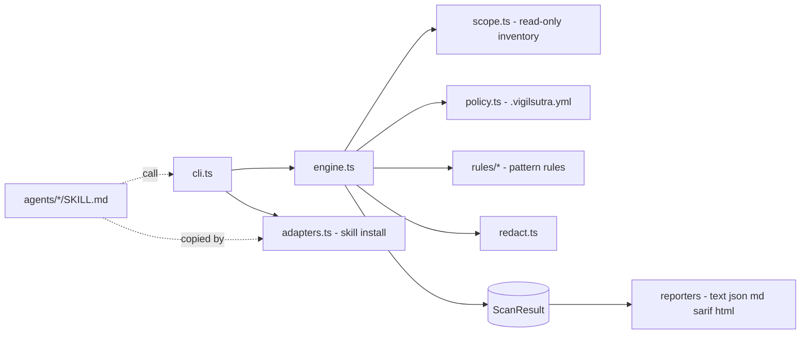

# Architecture

- **One engine, thin adapters.** The CLI is the only implementation of scanning. Skills tell an AI IDE how to run it and how to reason over its redacted output.
- **Scope manager** (`scope.ts`): canonicalises the root, never follows symlinks, skips binaries, enforces size, file-count and time limits, applies ignores.
- **Rules** (`rules/`): each declares id, version, severity, confidence, status, applicability and a `check` returning line hits.
- **Evidence**: the engine turns hits into findings, redacts every secret span found on a line, computes fingerprints, sorts deterministically.
- **Reporters** are pure functions of `ScanResult`.
- No runtime dependencies, no network, no subprocesses.

Not built yet: advisory provider, AI reasoning adapters, plugin runtime, remediation planner.
